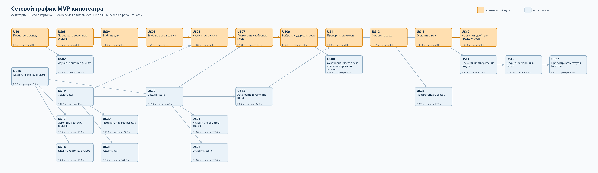

# Сетевой график и прогноз завершения MVP

Расчёт выполнен для 27 историй текущего состава MVP, то есть для всех историй, кроме US28. 

[Входной файл PERT](pert-tasks.csv).

Для прогноза принят тот же 12-недельный горизонт, что и в расчете емкости.

Параметр `--deadline` принимает **число в тех же единицах, что O, M, P**, и равен 180 часам.


## Сетевой график и критический путь



Узел показывает номер истории, название задачи, ожидаемую длительность **E** и **полный резерв**. Стрелка означает, что следующая история начинается после завершения предыдущей. Оранжевые узлы и стрелки обозначают критический путь.


Для каждой истории **E = (O + 4M + P) / 6**, **σ = (P − O) / 6**. Раннее начало ES равно максимальному раннему окончанию предшественников; EF = ES + E. Поздние сроки LS и LF получены обратным проходом от срока завершения всего графика; полный резерв = LS − ES. Все времена в таблице отсчитываются от старта работ в продуктивных часах.

| История | E, ч | ES | EF | LS | LF | Резерв, ч |
|---|---:|---:|---:|---:|---:|---:|
| US01 | 6,50 | 0,00 | 6,50 | 0,00 | 6,50 | 0,00 |
| US02 | 4,33 | 6,50 | 10,83 | 163,67 | 168,00 | 157,17 |
| US03 | 6,50 | 6,50 | 13,00 | 6,50 | 13,00 | 0,00 |
| US04 | 4,33 | 13,00 | 17,33 | 13,00 | 17,33 | 0,00 |
| US05 | 6,50 | 17,33 | 23,83 | 17,33 | 23,83 | 0,00 |
| US06 | 10,83 | 23,83 | 34,67 | 23,83 | 34,67 | 0,00 |
| US07 | 13,00 | 34,67 | 47,67 | 34,67 | 47,67 | 0,00 |
| US08 | 18,67 | 73,67 | 92,33 | 149,33 | 168,00 | 75,67 |
| US09 | 26,00 | 47,67 | 73,67 | 47,67 | 73,67 | 0,00 |
| US10 | 36,00 | 132,00 | 168,00 | 132,00 | 168,00 | 0,00 |
| US11 | 4,33 | 73,67 | 78,00 | 73,67 | 78,00 | 0,00 |
| US12 | 8,67 | 78,00 | 86,67 | 78,00 | 86,67 | 0,00 |
| US13 | 45,33 | 86,67 | 132,00 | 86,67 | 132,00 | 0,00 |
| US14 | 6,50 | 132,00 | 138,50 | 136,33 | 142,83 | 4,33 |
| US15 | 18,67 | 138,50 | 157,17 | 142,83 | 161,50 | 4,33 |
| US16 | 8,67 | 0,00 | 8,67 | 13,00 | 21,67 | 13,00 |
| US17 | 6,50 | 8,67 | 15,17 | 161,50 | 168,00 | 152,83 |
| US18 | 4,33 | 8,67 | 13,00 | 163,67 | 168,00 | 155,00 |
| US19 | 17,33 | 0,00 | 17,33 | 4,33 | 21,67 | 4,33 |
| US20 | 13,00 | 17,33 | 30,33 | 155,00 | 168,00 | 137,67 |
| US21 | 6,50 | 17,33 | 23,83 | 161,50 | 168,00 | 144,17 |
| US22 | 13,00 | 17,33 | 30,33 | 21,67 | 34,67 | 4,33 |
| US23 | 10,83 | 30,33 | 41,17 | 157,17 | 168,00 | 126,83 |
| US24 | 10,83 | 30,33 | 41,17 | 157,17 | 168,00 | 126,83 |
| US25 | 8,67 | 30,33 | 39,00 | 65,00 | 73,67 | 34,67 |
| US26 | 8,67 | 86,67 | 95,33 | 159,33 | 168,00 | 72,67 |
| US27 | 6,50 | 157,17 | 163,67 | 161,50 | 168,00 | 4,33 |

Полный [вывод `pert_cpm.py`](pert-output.txt) содержит те же сроки и схему Mermaid.

## Вероятность завершения

При сроке **180 часов** нормальное приближение PERT даёт:

```text
z = (D − E) / σ = (180 − 168) / 16,28 = 0,74
P(T ≤ 180) = Φ(0,74) ≈ 77,0 %
```

Скрипт печатает **77,0 %**. Расчёт предполагает неизменный критический путь и независимость длительностей его историй; при задержке соседней ветви критический путь может измениться. 

## Монте-Карло по условной пропускной способности

До накопления фактических данных взята условная недельная история **[1, 2, 3, 4] завершённые истории**.


| Показатель | Прогноз от условной нулевой недели |
|---|---:|
| Средняя условная пропускная способность | 2,5 истории в неделю |
| Завершение с вероятностью не менее 50 % | не позднее 11 недель |
| Завершение с вероятностью не менее 85 % | не позднее 13 недель |
| Завершение за 12 недель | 81 576 из 100 000 прогонов, около 81,6 % |

Полный [вывод](monte-carlo-output.txt) сохранено отдельно. 
